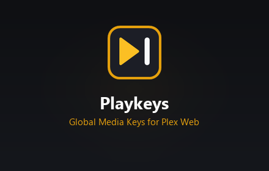
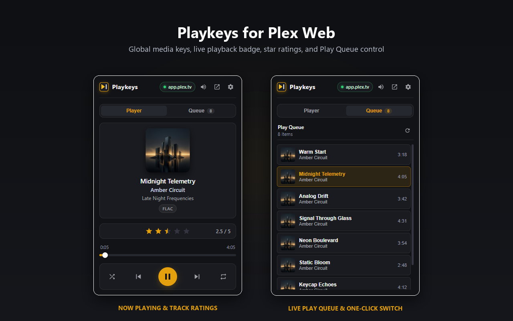
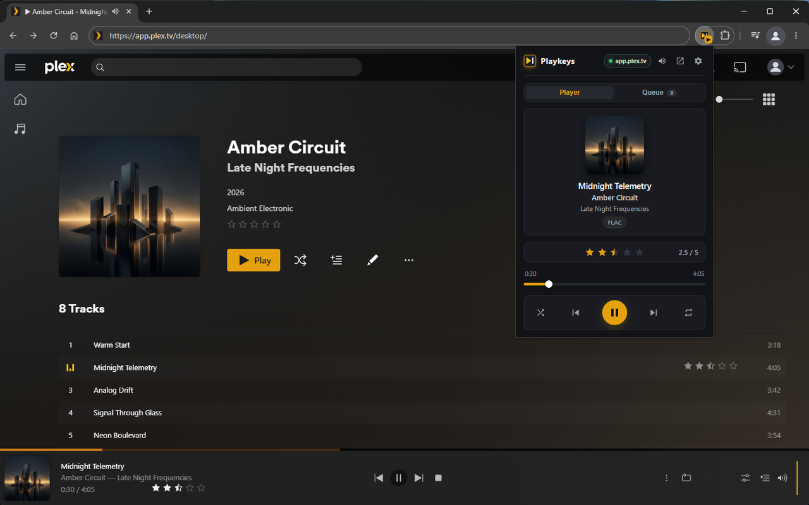

# Playkeys for Plex Web

[](https://chromewebstore.google.com/detail/playkeys-for-plex-web/pmkoebhamaccefjlpmjgnfckibhmfdpa)
[](https://developer.chrome.com/docs/extensions/mv3/intro/)
[](LICENSE)

A Chrome extension that adds global media keys, playback status badges, and a popup controller for Plex Web (`app.plex.tv`) and self-hosted Plex servers.

---

## Features

- **Global media shortcuts:** Control playback with hardware media keys (`Play/Pause`, `Next`, `Previous`, `Stop`) or custom shortcuts from anywhere in your OS.
- **Playback badge:** Extension icon displays current status (playing or paused) at a glance.
- **Popup player:** Track info, album art, progress bar with scrubbing, volume slider, track ratings (5-star half/whole or thumbs up/down), Play Queue tab with track selection, and playback controls.
- **Custom server support:** Connect local or self-hosted Plex Media Server instances on demand.
- **Lightweight & private:** Manifest V3, no external dependencies or build steps, and zero telemetry.

---

## Screenshots

<p align="center">
  
</p>





---

## Keyboard Shortcuts

| Action | Default Shortcut | Scope | Description |
| :--- | :--- | :--- | :--- |
| **Play / Pause** | `MediaPlayPause` | Global | Toggle playback in active Plex tab |
| **Next Track** | `MediaNextTrack` | Global | Skip to next track or episode |
| **Previous Track** | `MediaPrevTrack` | Global | Return to previous track or restart current |
| **Stop** | `MediaStop` | Global | Stop playback and clear badge |
| **Volume Up** | *Unassigned* | In Chrome / Global | Increase volume by 5% |
| **Volume Down** | *Unassigned* | In Chrome / Global | Decrease volume by 5% |
| **Toggle Mute** | *Unassigned* | In Chrome / Global | Mute / unmute audio |

Shortcuts (including optional volume keys, due to Chrome's 4-default-shortcut limit) can be customized at `chrome://extensions/shortcuts`.

---

## Installation

### Chrome Web Store (Recommended)

Install directly from the [Chrome Web Store](https://chromewebstore.google.com/detail/playkeys-for-plex-web/pmkoebhamaccefjlpmjgnfckibhmfdpa).

### Manual Installation

1. Clone or download this repository:
   ```bash
   git clone https://github.com/bowuu/playkeys.git
   ```
2. Open Google Chrome and navigate to `chrome://extensions`.
3. Enable **Developer mode** in the top-right corner.
4. Click **Load unpacked** and select the `playkeys` directory.
5. Pin Playkeys to your toolbar for easy access.

---

## Custom Servers

By default, Playkeys requests permissions only for `https://app.plex.tv/*`.

To connect a local or self-hosted server:
1. Open the Playkeys popup and click the settings icon (or right-click the extension icon and select **Options**).
2. Enter your server address (e.g. `http://localhost:32400` or `http://192.168.1.100:32400/web`).
3. Click **Request Permission & Add** and approve Chrome's origin prompt.

---

## Privacy

Playkeys does not collect, track, or transmit any user data, credentials, listening history, or analytics. All operations occur locally in the browser. See [PRIVACY_POLICY.md](PRIVACY_POLICY.md) for details.

---

## Development

Developer guidelines and internal documentation are maintained in [`bowuu/agent-rules`](https://github.com/bowuu/agent-rules) (`repos/playkeys/AGENTS.md`).

---

## Disclaimer

Plex is a registered trademark of Plex, Inc. Playkeys is an independent open-source project and is not affiliated with or endorsed by Plex, Inc.

---

## License

[MIT](LICENSE)
